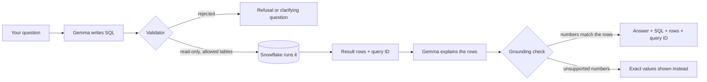

# DataMind: talk to your data

DataMind lets you ask a question about your data in plain English and get an answer you can check. Gemma (through Ollama) turns the question into SQL, a read-only validator checks that SQL, Snowflake runs it on the real tables, and Gemma explains only the rows that came back. Every answer comes with the SQL that actually ran, the result rows and the Snowflake query ID, so you never have to take the model's word for anything.

We built it for ZeroDay OSS Hacktoberfest 2026 (problem statement PS1). It's meant for people who know what they want to ask but don't write SQL: analysts, students, small teams, anyone handed a database and a deadline.

**Our main contribution:** a small, readable data agent where the language model never touches the numbers. Snowflake computes every figure, a validator stands between the model and the database, and a grounding check rejects any explanation that mentions a number not found in the result rows.

## Contents
- [How it works](#how-it-works)
- [Datasets](#datasets-and-licences)
- [Getting started](#getting-started)
- [Everyday use](#everyday-use)
- [Configuration](#configuration)
- [Using the Snowflake layer from your own code](#using-the-snowflake-layer-from-your-own-code)
- [Project layout](#project-layout)
- [Tests and evaluation](#tests-and-evaluation)
- [Known limitations](#known-limitations)
- [Troubleshooting](#troubleshooting)
- [Privacy and security](#privacy-and-security)
- [Contributing](#contributing)
- [Credits and licence](#credits-and-licence)

## How it works



A few rules hold the design together:

- **Gemma translates and explains. It never computes.** Every number in an answer comes from a query Snowflake ran when you asked.
- **The validator is the gate.** It parses the SQL with sqlglot and allows one read-only statement, only on tables listed in `datasets.yaml`, using approved join keys and known functions, and it adds a `LIMIT` when one is missing. The app also logs in with a read-only Snowflake role, so a slip in the validator still can't write anything.
- **The prompt is built from the live schema.** Column names and types come from Snowflake's `INFORMATION_SCHEMA` at start-up. The only hand-written knowledge is what's in `datasets.yaml`: what columns mean, which joins are allowed, how metrics like revenue are defined.
- **Empty results bypass the model.** If a query returns nothing, you're told so plainly. Nothing gets invented.
- **Unclear questions get a question back.** "Show me top sales" asks what you mean by top and by what grouping, or answers while stating its assumption.

## Datasets and licences

Each source lives in its own Snowflake database:

| Snowflake database | Dataset | Tables | Source and licence |
|---|---|---|---|
| `SNOWFLAKE_SAMPLE_DATA` (`TPCH_SF1`) | `tpch` | 8 TPC-H tables | Snowflake sample data, read in place and not copied here. No open licence stated. |
| `SNOWFLAKE_SAMPLE_DATA` (`TPCDS_SF10TCL`) | `tpcds` | 12 TPC-DS tables (`STORE_SALES` alone has 28.8 billion rows) | Snowflake sample data, read in place. No open licence stated. |
| `UCI` (`PUBLIC`) | `wine_quality` | `WINE_QUALITY` (6,497 rows) | UCI Wine Quality (id 186), CC BY 4.0. |
| `UCI` (`PUBLIC`) | `bank_marketing` | `BANK_MARKETING` (45,211 rows) | UCI Bank Marketing (id 222), CC BY 4.0. |
| `UCI` (`PUBLIC`) | `student_performance` | `STUDENT_PERFORMANCE` (649 rows) | UCI Student Performance (id 320), CC BY 4.0. |
| `OWID` (`PUBLIC`) | `owid` | `LIFE_EXPECTANCY`, `GDP_PER_CAPITA`, `POPULATION` | Our World in Data (life expectancy, GDP per capita, population with UN projections). CC BY 4.0 for the processed data. Underlying sources: Riley (2005), Zijdeman et al. (2015), HMD (2025), UN WPP (2024); Eurostat, OECD, IMF and World Bank (2026). Please credit Our World in Data and the original sources. |

`setup.sql` creates the `UCI` and `OWID` databases and the roles. `load_data.py` downloads the UCI and Our World in Data files straight from their sources into your own Snowflake account. No dataset files are stored in this repository.

A note on TPC-DS: its tables are huge, so a TPC-DS question can take anywhere from a few seconds to a few minutes on an XSMALL warehouse and costs more trial credit than the other datasets. The catalogue tells Gemma to filter by year first, and `.env.example` sets the statement timeout to 300 seconds (the code falls back to 60 if you leave it out).

## Getting started

### What you need
- **Python 3.10 or newer.** We tested on 3.12.10.
- **A Snowflake account.** A free trial (signup.snowflake.com) is enough. It needs only an email address and lasts 30 days.
- **Access to Gemma**, one of:
  - an Ollama API key (https://ollama.com/settings/keys) to use `gemma4:31b` on Ollama's servers. This is what we tested with.
  - Ollama installed locally with `ollama signin`, then `GEMMA_MODEL=gemma4:cloud`.
  - Ollama fully local with a smaller model, for example `ollama pull gemma3n:e4b` (about 9.8 GB) or `gemma3n:e2b` (about 7.8 GB). Smaller models are slower on a laptop and we haven't measured their accuracy on our evaluation set.

### Windows (quickest)
1. In a Snowsight worksheet, run `setup.sql` as ACCOUNTADMIN ("Run all"). It creates the warehouse, the two source databases, a read-only role (`DM_READER`) and a loader role (`DM_LOADER`).
2. Run `run.bat keygen`. It creates a key pair, writes the key path into `.env` and prints one block of SQL. Paste that SQL into Snowsight and run it as ACCOUNTADMIN. It creates a service user called `DM_APP` that logs in with the key.
3. Open `.env` and set `SNOWFLAKE_ACCOUNT` (the part of your Snowsight URL after the region, for example `ab12345.ap-southeast-7.aws`) and `SNOWFLAKE_USER=DM_APP`. Add your `OLLAMA_API_KEY`, or follow the local options in `.env.example`.
4. Run `run.bat`. It creates `.venv`, installs the pinned packages, loads any dataset that's missing, checks everything and opens the app in your browser.

### macOS and Linux
`run.bat` is Windows-only, but every step it takes is a plain Python command:

```bash
python3 -m venv .venv
source .venv/bin/activate
pip install -r requirements.txt
cp .env.example .env              # then fill it in, see the Windows steps above
python -m datamind.keys           # creates the key pair and prints the SQL to register it
python -m datamind.preflight      # exit code 0 = ready, 2 = datasets not loaded yet, 1 = something to fix
python load_data.py               # loads the UCI and Our World in Data tables
python -m streamlit run app.py
```

We developed and tested on Windows. The Python steps above should behave the same elsewhere, but we haven't run them on macOS or Linux ourselves.

### Tested on
Windows 10 Pro 22H2 (build 19045), Intel Core i5-11400H, 16 GB RAM, Python 3.12.10, `gemma4:31b` through Ollama's cloud API (nothing downloaded locally), Snowflake trial account with an XSMALL warehouse. Package versions are pinned in `requirements.txt`.

## Everyday use

| Command | What it does |
|---|---|
| `run.bat` | Start the web app and open it in your browser |
| `run.bat check` | Run the pre-flight checks only |
| `run.bat ask "How many orders are there?"` | Ask one question in the terminal |
| `run.bat load` | Load the UCI and Our World in Data tables into Snowflake (overwrites existing tables) |
| `run.bat live` | Prove the Snowflake layer works against your account |
| `run.bat smoke` | Run the routing checks against real Gemma and Snowflake |
| `run.bat eval` | Run the ground-truth evaluation (`eval --truth-only` just prints the expected answers) |
| `run.bat keygen` | Create a key pair and print the SQL that registers it |
| `run.bat test` | Run the offline unit tests |
| `run.bat repair` | Reinstall all packages |

In the app, each answer has a "How this was obtained / evidence" panel with the tables used, the stated assumptions, the executed SQL, the Snowflake query ID and the rows. You can look the query ID up in Snowsight under Monitoring, then Query History. The sidebar lists every dataset with its source and licence.

**Questions that span datasets:** if one question asks for separate facts from different datasets (for example "the average alcohol of red wine, and how many bank clients subscribed to a term deposit"), DataMind splits it into parts, answers each part from its own dataset with the same validator, read-only role and grounding check, and shows them as Part 1, Part 2 and so on. Each part has its own SQL and Snowflake query ID in the Results and Query tabs. Parts are never merged: no combined figure is calculated, because the datasets have no declared link, and the answer says so. At most 3 parts are used, a part can't split again, and a part that fails doesn't hide the parts that worked. Set `DM_MULTIPART=0` in `.env` to turn the feature off.

**Trace tab:** the last tab of each answer is a timestamped record of what the code did for that question, the same lines as the terminal's live trace: the question received, each Gemma call with its size and time, each network request and HTTP status, the validator's verdict, the SQL with its Snowflake query ID, the grounding check, and the follow-up suggestions. Each line has a clock time and the milliseconds since the question started, and the tab summarises the number of steps, Gemma calls and Snowflake statements. You can download it as a text file. It is recorded while the question runs, saved with the chat, and works even when the terminal trace is off. Keys, tokens and passwords are never recorded.

**Data library, live:** each dataset in the sidebar's Data library lists the tables Snowflake actually has, with their column and row counts (read from the live schema), and the source picker shows how many of each dataset's tables were found. This is the same live schema DataMind reads to build the prompt, so you can see what Gemma is working from.

**Cost & reliability:** the sidebar's Studio section has a Cost & reliability panel for the current conversation, built only from the traces the code recorded: questions, answered and error counts, median and slowest time per question, Gemma calls and time, Snowflake statements and time, retries, validator and Snowflake rejections, Gemma failures, the three slowest statements with their query IDs, and an estimate of warehouse credits (query time at the warehouse's rate, set with `DM_WAREHOUSE_CREDITS_PER_HOUR`, default 1 for an XSMALL). It is an estimate, not billing: Snowflake also bills idle time and a 60-second minimum each time the warehouse resumes, and the real figures live in `SNOWFLAKE.ACCOUNT_USAGE`, which needs admin rights. Set `DM_CREDIT_BUDGET` (in credits) to get a budget bar and a warning at 80%.

**Visualisation tab:** next to Results, Query and Evidence, every answer with data has a Visualisation tab. It picks a chart from the shape of the returned rows and the wording of your question: a bar chart for labels and numbers, a line for change over time, a donut for shares of a few categories, a scatter for two numbers, a histogram for a spread of values, and plain number cards for a single row. You can switch the chart type, the grouping and the value column. Charts are drawn only from the rows Snowflake returned (nothing is re-queried, smoothed or estimated), and a chart that would show more than 30 bars says it is cut off. The Results tab is unchanged. Charts use Altair, which ships with Streamlit, so there is nothing extra to install.

**Follow-up ideas:** under the latest answer, DataMind suggests three follow-up questions. Gemma writes them from that answer's question, SQL and rows, the earlier questions in the chat and the datasets that are switched on, so they refer to the real data ("these 5 countries", "1996"). Clicking one asks it like any other question, so it goes through the same validator and Snowflake. In our checks 9 of 9 suggestions were answerable, but a suggestion can occasionally need a query the validator won't allow, and you'll see a clear refusal. If Gemma can't produce suggestions, the answer is shown without them.

**Choosing which sources to ask:** the sidebar's Data sources box lists every dataset, with the number of its tables found live in Snowflake (for example `TPCH 8/8`). Remove the ones you don't want and only the rest are used: Gemma only sees those tables, and the validator only allows them. If you ask about a switched-off dataset, DataMind says so and tells you which one to switch on. By default every source is selected, and the choice applies to the current browser session.

### The live trace
`run.bat` prints a line for every connection, network call, SQL statement, model call and workflow step as it happens, with sizes and timings. It's there so you can see what the code is really doing. The same lines go to `logs/datamind.log`. Add `--quiet` to any command, or set `DM_TRACE=0`, to turn it off. It changes nothing else.

```
15:18:08.317  ASK       question received (57 chars, 0 earlier turn(s) in context): Which 5 countries had ...
15:18:08.317  GEMMA     -> gemma4:31b via https://ollama.com | system prompt 24675 chars, user message 67 chars, max_tokens=700, json mode
15:18:08.516  NET       POST https://ollama.com/api/chat (ollama) sending 25118 bytes
15:18:09.563  NET       POST ollama.com/api/chat -> HTTP 200 (595 bytes) in 1046 ms
15:18:09.563  GEMMA     <- ok 1246 ms response_chars=323 prompt_tokens=7809 output_tokens=121
15:18:09.564  PLAN      attempt 1: Gemma chose action='query', sql=160 chars, assumptions=1
15:18:09.580  VALIDATE  accepted: read-only, tables=['OWID.PUBLIC.GDP_PER_CAPITA']; sql 160 chars -> 160 chars to execute
15:18:09.581  SQL       -> 160 chars: SELECT ENTITY, GDP_PER_CAPITA FROM OWID.PUBLIC.GDP_PER_CAPITA WHERE YEAR = 2020 ...
15:18:09.717  SQL       <- ok 136 ms query_id=01c7cf4c-000e-1619-0000-0002b55a6e4d columns=2 rows=5 result_chars=118
15:18:11.901  GROUND    explanation 510 chars; every number appears in the result rows or question: True
15:18:11.902  ASK       answer ready: status=answered query_id=01c7cf4c-000e-16cf-0002-b55a0001959e rows=5 total=3.6s
```

| Tag | What it shows |
|---|---|
| `ENV` | Python, OS, package versions, settings (secrets only show as set or empty) and the datasets read from `datasets.yaml` |
| `SNOWFLAKE` | each connection: account, user, role, warehouse, login method (never the secret), statement timeout, session id |
| `NET` | each HTTP request from the Snowflake connector and the Ollama client: method, path, status, bytes, time. Headers and query strings are never shown |
| `SQL` | each statement: length, the start of the text, then query id, columns, rows, result size and time |
| `GEMMA` | each model call: model, host, prompt sizes, response size, token counts, time |
| `SCHEMA`, `PLAN`, `VALIDATE`, `GROUND`, `ASK`, `UI`, `EVAL`, `DOWNLOAD`, `LOAD` | the workflow steps, from building the prompt to the final answer |

## Configuration

### Settings in `.env`
Copy `.env.example` to `.env`. It's gitignored, so your secrets stay on your machine.

| Variable | What it's for |
|---|---|
| `SNOWFLAKE_ACCOUNT`, `SNOWFLAKE_USER` | Your account identifier and the login user (`DM_APP` if you used `run.bat keygen`) |
| `SNOWFLAKE_PRIVATE_KEY_PATH` | Key-pair login (recommended). `run.bat keygen` fills this in |
| `SNOWFLAKE_PAT`, `SNOWFLAKE_PASSWORD` | Alternatives to the key. Priority is key, then token, then password |
| `SNOWFLAKE_WAREHOUSE`, `SNOWFLAKE_READER_ROLE`, `SNOWFLAKE_LOADER_ROLE` | Defaults match `setup.sql`: `DM_WH`, `DM_READER`, `DM_LOADER` |
| `DM_STATEMENT_TIMEOUT` | Seconds before Snowflake cancels a statement. Protects your credits |
| `OLLAMA_HOST`, `OLLAMA_API_KEY`, `GEMMA_MODEL` | Where Gemma runs and which variant. Leave host and key empty for local Ollama |
| `DM_TRACE` | `1` prints the live trace, `0` hides it |
| `DM_WAREHOUSE_CREDITS_PER_HOUR`, `DM_CREDIT_BUDGET` | Warehouse rate (default 1) and an optional credit budget for the Cost & reliability estimate |
| `DM_MULTIPART` | `0` turns off splitting a question across datasets |

### Adding a dataset
You add a dataset in `datasets.yaml`, not in code. The minimum is a name, database, schema and the list of tables. The more you describe, the better the answers get:

- `columns`: what each column means, in plain words
- `joins`: the only join conditions the validator will accept
- `metrics`: business definitions the model must follow, such as how revenue is calculated
- `notes`, `scope` and `examples`: one line per table, the data's coverage, and a few question-to-SQL examples

To have the data loaded for you, add a `load:` recipe: `type: uci` with a `uci_id`, or `type: csv` with a `url`, plus the `table` name and an optional `rename:`. Use a list of recipes for a dataset with several tables. Then run `run.bat load` (or `python load_data.py`).

One honest warning: config alone doesn't prove the answers are right. A new dataset needs a few evaluation questions of its own before you trust it.

### Automatic tables (optional)
Instead of a list, `tables: auto` lets Snowflake decide which tables a dataset has. For example, `{name: extras, description: Extra tables, database: UCI, schema: PUBLIC, tables: auto}` picks up any table or view in that schema that the read-only role can see, minus tables another dataset already lists. This happens at start-up, or when you press "Re-scan tables" in the sidebar. Discovered tables get live column names and types but no meanings, joins or metrics, so answers about them are weaker until you describe them. The shipped config doesn't use it, because every table is listed explicitly.

## Using the Snowflake layer from your own code

If you have your own AI layer and just want safe, read-only Snowflake access, use the executor:

```python
from datamind.executor import make_executor

executor = make_executor()                  # logs in lazily with the read-only role
result = executor("SELECT COUNT(*) AS N FROM SNOWFLAKE_SAMPLE_DATA.TPCH_SF1.ORDERS")
# {"rows": [{"N": 1500000}], "columns": ["N"], "query_id": "01c7...", "truncated": False}
executor.close()                            # or: with make_executor() as executor: ...
```

| Behaviour | Detail |
|---|---|
| Read-only | Only `SELECT` and `WITH` statements run, and the login uses the read-only role `DM_READER` |
| SQL errors | Raised unchanged (`snowflake.connector.errors.ProgrammingError`) so your code can repair the SQL |
| Lost session | An expired token or dropped connection is reopened once and the query retried. A second failure is raised |
| Result cap | `max_rows` (default 1000). `truncated` is `True` when there was more |
| Statement timeout | `DM_STATEMENT_TIMEOUT` seconds per statement (60 if unset), so a runaway query can't burn your credits |
| Duplicate column names | Get `_2`, `_3` suffixes instead of overwriting each other |

## Project layout

```
app.py                   Streamlit web app
datasets.yaml            datasets, tables, meanings, joins, metrics and load recipes
setup.sql                one-time Snowflake setup (warehouse, databases, roles)
load_data.py             loads the UCI and Our World in Data tables
live_check.py            proves the Snowflake layer works against a real account
run.bat                  Windows launcher (venv, packages, checks, commands)
datamind/
  agent.py, models.py    the question -> SQL -> rows -> explanation workflow and its result type
  llm.py, prompts.py     Gemma calls and prompt text (no data access)
  snowflake_client.py    login and running SQL (the only data access)
  executor.py            read-only Snowflake callable for other AI layers
  catalog.py             live schema plus the knowledge from datasets.yaml
  validator.py           read-only SQL guardrail
  grounding.py           checks that numbers in an explanation exist in the rows
  config.py              reads datasets.yaml and settings
  preflight.py           readiness checks
  keys.py, ports.py, cli.py, logs.py, trace.py   key setup, free port, terminal questions, logging, live trace
eval/                    ground-truth evaluation, routing smoke test and their results
tests/                   offline unit tests (no Snowflake or Gemma needed)
```

Each module does one job. Gemma never computes data and Snowflake never interprets language, and we'd like to keep it that way.

## Tests and evaluation

- **Unit tests:** `run.bat test` (or `python -m pytest tests -q`). 175 tests, all offline. They cover the validator, grounding, the workflow with fakes, response parsing, config, table discovery, the data-source selector, follow-up suggestions, multipart questions, the chart logic, the per-answer trace capture, the executor, the trace and the evaluation comparer.
- **Routing smoke test:** `run.bat smoke`. 9 live cases checking that questions are answered, clarified or refused as they should be, including a prompt-injection attempt. Result: 9/9.
- **Ground-truth evaluation:** `run.bat eval`. 83 questions across all six datasets, including 3 that span datasets. Each one has SQL we wrote by hand and ran directly in Snowflake, compared against the agent's rows. Results are saved in `eval/results/`, with a Snowflake query ID for every answer.

The numbers, honestly:

- The first run, on the original 47 TPC-H and wine questions with no tuning, scored **45/47 (96%)** (`eval/results/run1_before_fixes.md`). One failure was a real agent mistake (grouping parts by a name that isn't unique), which we fixed with a general prompt rule. The other was a truth case that asked for more than the question did, which we corrected.
- We then added Our World in Data, Bank Marketing and Student Performance (19 cases, all passed the first time) and TPC-DS (11 cases). Last, we added 3 questions that span datasets and re-ran everything after changing the prompt: the full run scored **83/83** (`eval/results/latest.md`), so the earlier 80 did not regress.
- Treat the 96% first run as the fair estimate. The 100% comes after fixing what the set showed us, and the set is small. The questions are never used as prompt examples, but judges' unseen questions may well behave differently.

What adding more datasets taught us:

- A question comparing two years with aliased CTEs was wrongly refused by the validator. That was a bug. We fixed it and added a unit test and an eval case (`o09`).
- TPC-H and TPC-DS both have customers and revenue, so three of the original questions became ambiguous, and one quietly counted TPC-DS customers. A blanket "always ask which dataset" rule made things worse (54/80 on that run), so we reverted it. Instead, `datasets.yaml` now says generic retail questions default to TPC-H and the answer lists that assumption. We reworded three questions to name TPC-H and added unspecified versions as ambiguity cases. Because of that rewording, the 100% isn't a clean held-out result for those three.
- The model varies a little from run to run. Once it wrote `'Germany'` where TPC-H stores `GERMANY`. We documented the uppercase names in the config.

## Known limitations
- Accuracy depends on the Gemma model. We've only measured `gemma4:31b`. Smaller local models will be less accurate, and we haven't put a number on how much.
- The facts in `datasets.yaml` (meanings, metrics, defaults) are followed literally. If a definition there is wrong, the answer will be wrong in the same way.
- The evidence panel lists tables, assumptions, SQL, rows and query ID. Filters aren't listed separately by code, so for those you read the SQL or the explanation.
- TPC-DS questions can be slow and cost more credit, as described above.
- Snowflake is cloud-only, so the app needs an internet connection and a live account.
- `run.bat` is Windows-only. macOS and Linux users run the Python commands directly.

## Troubleshooting

| You see | What to do |
|---|---|
| `.env not found` | Copy `.env.example` to `.env` and fill it in. `run.bat` does this for you on first run. |
| `no Snowflake credentials` | Run `run.bat keygen` and paste the SQL it prints into Snowsight. |
| `private key file not found` | The key path in `.env` is wrong or the key was moved. Run `run.bat keygen` again. |
| `Snowflake login: ... JWT token is invalid` | The public key isn't registered for that user, or the user name doesn't match. Use the `DM_APP` user that `run.bat keygen` sets up, and run the SQL it printed. |
| A programmatic access token is rejected | Snowflake requires a network policy before it accepts tokens. Key-pair login avoids this. |
| `tables not found: ...` | The UCI and Our World in Data tables aren't loaded yet. Run `run.bat load`. |
| `OLLAMA_HOST points to Ollama cloud but OLLAMA_API_KEY is empty` | Add your key from https://ollama.com/settings/keys, or switch to local Ollama (see `.env.example`). |
| `Gemma rejected the credentials` | Check `OLLAMA_API_KEY`, or run `ollama signin` if you use local Ollama with a cloud model. |
| A TPC-DS question times out | Raise `DM_STATEMENT_TIMEOUT` in `.env`, or narrow the question to a year or a category. |
| `UCI` and `OWID` don't appear in Snowsight | You're probably browsing as ACCOUNTADMIN, which doesn't own them. Switch the role to `DM_READER` (bottom-left menu, then Switch Role). |
| The web app port is busy | `run.bat` picks the next free port automatically and prints the address. |
| Anything else | Read `logs/datamind.log`. It has the full error, while the app only shows a short, safe message. |

## Privacy and security
- If you use Ollama's cloud, your question and up to 50 result rows are sent to Ollama's servers for the explanation step. Use a local Ollama model to keep everything on your machine.
- Secrets live only in `.env` and `.keys/`, and both are gitignored. The live trace and the logs never print keys, tokens or passwords.
- The app logs in with a read-only role and the validator only lets read-only SQL through.
- Found a security problem? Please see [SECURITY.md](SECURITY.md) rather than opening a public issue.

## Contributing
Contributions are welcome, from typo fixes to new datasets. [CONTRIBUTING.md](CONTRIBUTING.md) explains how to set things up, what we test before merging and how to add a dataset. Please also read our [Code of Conduct](CODE_OF_CONDUCT.md).

## Credits and licence
The semantic catalogue idea, the number-grounding check, the function and join allowlists and the first seven routing cases were adapted from our team's AI-module handoff package (MIT).

Data comes from Snowflake's sample data, the UCI Machine Learning Repository and Our World in Data. See [Datasets and licences](#datasets-and-licences) for the terms of each.

The code is released under the [MIT Licence](LICENSE). You're free to use it, change it and share it, including commercially, as long as you keep the copyright notice.
